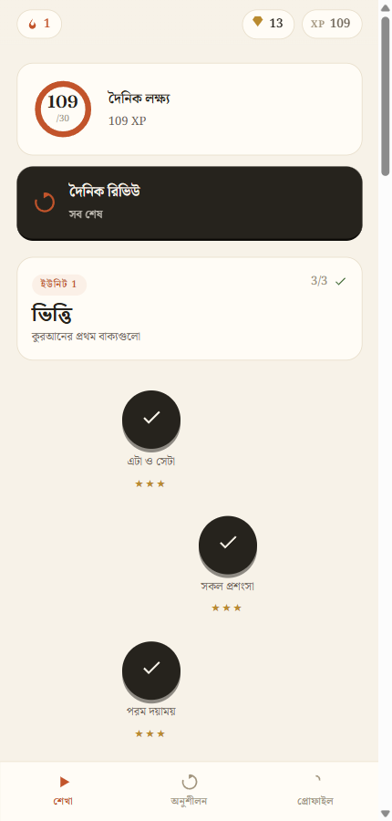
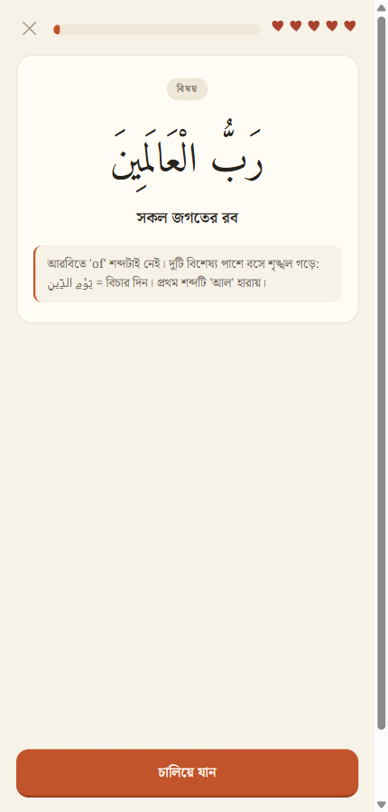
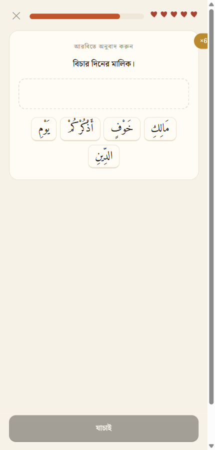

# Bayan — Quranic Arabic micro-learning (prototype)

Micro-learning app for **Quranic Arabic** in the shape of a Duolingo-style path:
real Quranic verses only, frequency-ordered vocabulary, the Arabic root system, and
spaced review — in **English and বাংলা**.
One shared curriculum drives **two clients**: a dependency-free **web app** and a native
**Kotlin + Jetpack Compose Android app**.

> **Status: prototype.** Vocabulary order follows the Quranic Arabic Corpus frequency
> data; context notes summarize classical asbāb al-nuzūl collections and well-attested
> hadith. Verify scholarly content before wider release.

## Screenshots (web client)

| Home path | Concept card | Translate exercise |
|---|---|---|
|  |  |  |

## Clients

| Client | Path | Run |
|---|---|---|
| Web | `web/index.html` | open it directly, or serve `web/` statically |
| Android | `android/` | `assembleDebug` with JDK 17 + Gradle 8.9 (see below) |

## Build the data

```bash
python curriculum/build.py     # validates + emits web/js/data.js and android assets
```

## Run the web app

```bash
cd web && python -m http.server 8890
# then open http://127.0.0.1:8890  (file:// also works)
```

## Build the Android APK

```bash
export JAVA_HOME="C:/Program Files/Eclipse Adoptium/jdk-17.0.20.8-hotspot"
cd android
"D:/Apps/gradle-8.9/bin/gradle.bat" assembleDebug
# APK: android/app/build/outputs/apk/debug/app-debug.apk
```

Install (device connected): `adb install -r app-debug.apk`

## What's inside

- `curriculum/` — the content: **8 units × 3 lessons**, ~115 vocabulary items,
  27 fully vocalized Quranic verses with asbab al-nuzul / story / theme context cards,
  76 root words. Units 1→8 go from THIS/THAT and nominal sentences to full-surah
  reading (Al-Fātiḥah, Al-ʿAṣr, Āyat al-Kursī).
- `web/` — static web client, no build step, `localStorage` persistence, Amiri +
  Fraunces + Noto Serif Bengali bundled locally. Arabic TTS via Web Speech API when an
  Arabic voice exists (listen exercises hide themselves otherwise).
- `android/` — Kotlin + Jetpack Compose client (AGP 8.4.0 / Kotlin 2.0.21 /
  Compose BOM 2024.12.01, minSdk 26, targetSdk 35). Same engine ported 1:1,
  `org.json` parsing from assets, `SharedPreferences` persistence, Android TTS.
- `DESIGN.md` — pedagogy, data schema, lesson-compiler spec, gamification math.

Shared learning loop: XP, daily-goal ring, streak flame, hearts (3-strikes per lesson),
combo bonus, gems, 12 achievements, unit-complete bonus, and a "Quranic coverage"
estimate. Retention: simplified SM-2 spaced repetition (intervals 0/1/2/4/8/16 days)
with a review queue that prioritizes flagged (missed) items, plus deliberate
interleaving — later lessons reference earlier items.

Exercise types: teach cards, asbab/story/theme context cards, read cards with
hidden translation, multiple choice both directions, tap-the-pairs, root
identification, word-bank sentence building, fill-the-blank, and listen (TTS).

## Sources

- Vocabulary/frequency: Quranic Arabic Corpus (top-100 words ≈ 55% of the text;
  300–500 roots ≈ 80%).
- Context: classical asbāb al-nuzūl collections (al-Wāḥidī, Ibn Kathīr summaries),
  surah introductions, and well-attested ṣaḥīḥ hadith, phrased as short reports.
- Translations: English and Bangla study glosses by the author — not a substitute
  for a published tarjama.

MIT licensed. Built by Md Sadman Bin Masud.
